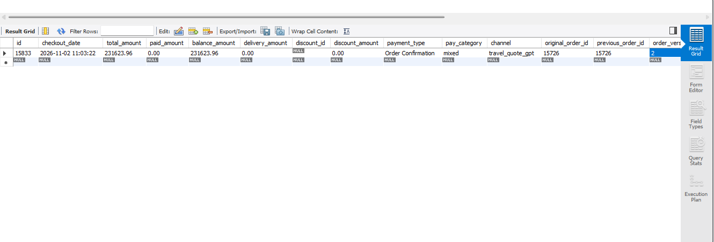
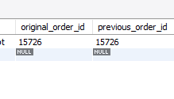

in the B2C BOokings 
Aahaas Flow Having n8n Project having system when Booking updatting creating new Booking System i need to apply this for OPS B2c Bookings and Invoice processo systems B2C invoice and B2C pnls Also need to update acordingly sutable for ths 
Update also need to identy fy and update without late .....

as example 

Initial oder is 
Order #15833 — amends #15726

need to update sutable way for that bookings and version also need to maintain and 

Need to Show Booking Updated booking Action need like Notice 
that dont need same day Updated Only need Old Amendments 

Safe live data safely do this update more creative and more creatively and more safely.....

