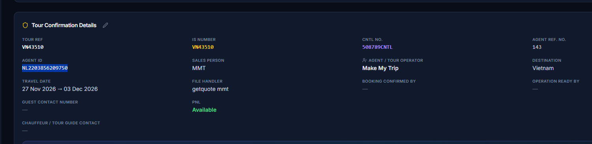
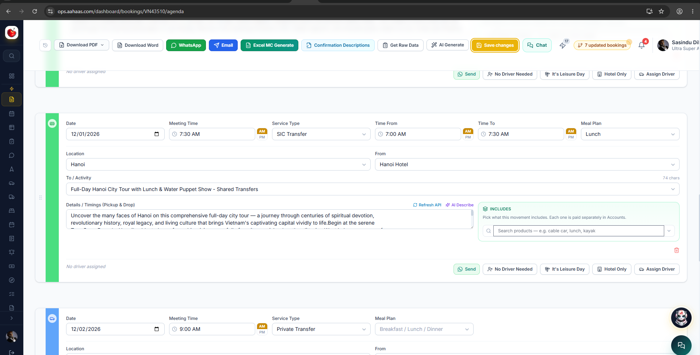

in the ops system 

create setting page component to manage this :
https://aahaas-my.sharepoint.com/:x:/p/sasindu/IQA-0icZdwz8QI67NC707tEXAVX3Fh9Wk8LJnEI516QQDOU?e=I8OmbZ

this excell need to add all the movements need to write here by arraival date

write from arrivale date decmber 1 to all that floud need to update time to time if the new booking created in the system that should be update 

need to add colums 

1.BookingArrivaldate : 
1.B2B or B2C       :  (example B2B   )
2.VN Number      (example : VN43510 )
2.CNTL number :   (example : 508789CNTL )
3.Agenda-line-id	: 
4.Name of guests	: (example : Raghav Gera)
5.Adult Count       :  (example : 2 )
6.Child	Count       :   (example : 1 )
7.Location          :   
8.From              :	
9.To/Tours	        :
10.Tour Description : 	
11.Meal Plan	    :
12.Meeting Time	(this dont put data from system this adding manually )
13.Service Type	 : 
14.Vendor	  (this dont put data from system this adding manually )
15.Agent - ID	  (example NL2203856209750 )
15.Agent - name   (Example Make My Trip)
16.Type of Car	(this dont put data from system this adding manually )
17.Text Message	(this dont put data from system this adding manually )
18.Local contact	(this dont put data from system this adding manually )
17.QC checked	(this dont put data from system this adding manually )
18.TICKETS	(this dont put data from system this adding manually )
19.Meal Preference	(this dont put data from system this adding manually )
20.SPECIAL NOTE	(this dont put data from system this adding manually )
22.Note	(this dont put data from system this adding manually )
23.Issues	(this dont put data from system this adding manually )
24.Issues responsible	(this dont put data from system this adding manually )
25.Dinner	(this dont put data from system this adding manually )
26.total	(this dont put data from system this adding manually )
27.xe	(this dont put data from system this adding manually )
28.guide (this dont put data from system this adding manually )

that details need to get booking details , and agenda details 

 agenda details need to add to this excell 

agenda having thins dropdown can view in the excell also 
