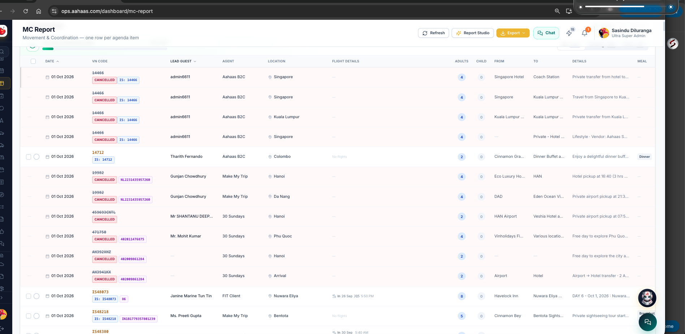

I NEED TO CREATE NEW FETURE FOR  Booking system and Accounts system 
use same tables for this in same database.

Page name should be Trans-Reconsultation

for now they using excell sheet for do this I need to create sheed automaticaly 
Here is sample excell sheet 

for one month there are 2 sheets 1-15das and 16-30or31days
need to get this lines service date using mc report
like every month need to do this 

Here is sample excel sheet apple-holidays/DevelopmentPromts/Malaysia 16th to 30th September 2026.xlsx 

Need to main tain that for each country seperatly malasia , singapoor, Vieatnam , srilanka 

 the should be need to create in the ops system 
in there rate are need to set manualy and can save from the ops 
Data fould need to get from MC report lines need to get  
Defult Dont show cancell bookings lines 

DATE	TOUR NO	GUEST NAME	PAX	PICK UP 	DROP OFF	TIME	DETAILS	   PNL DESCRIPTION   RATES(manual adding)    PNL RATE.    

find what kind of fields need to show(excell file) in the boooking system 
Add mc Description and perticular agenda lines Pnl's line description also add 
add one more colum name PNL value for that particulrline 

can add raws and can remove rows and need to safe 

When it gose to the Accounts system 

DATE	TOUR NO	GUEST NAME	PAX	PICK UP 	DROP OFF	TIME	DETAILS	   PNL DESCRIPTION   RATES(manual adding)    PNL RATE.  Diffrence   Approve

Diffrence mean PNL rate and manual adding rate difrence 
accounts team can approve and not approve .....

